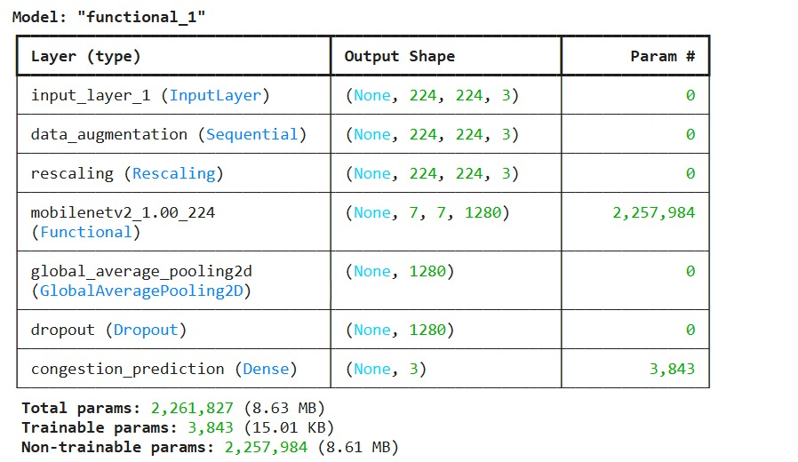
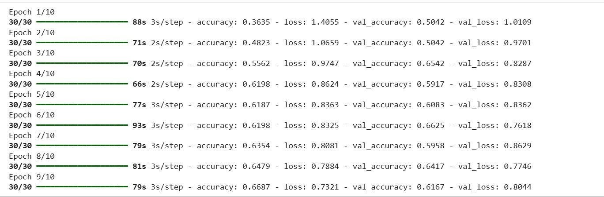
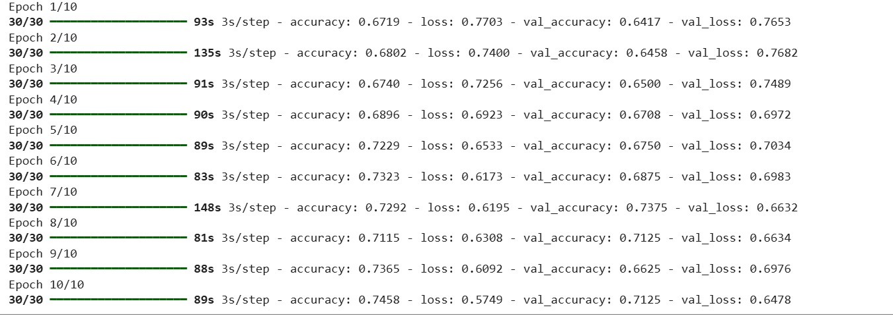
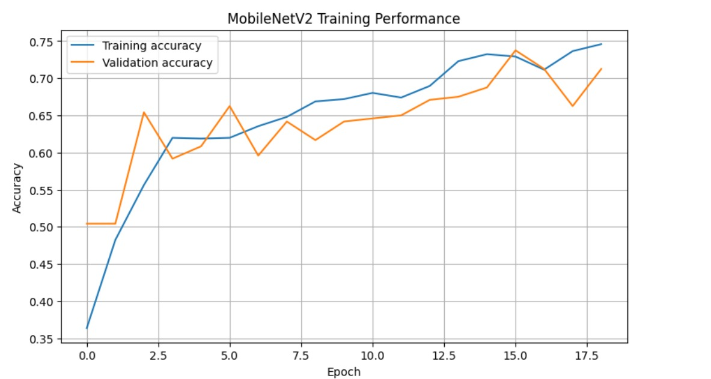
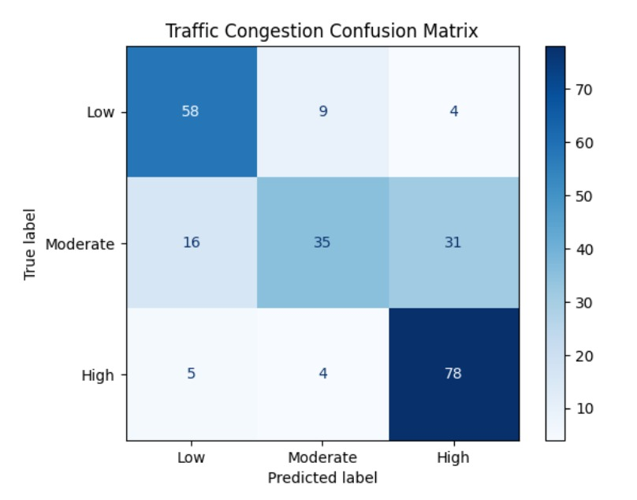
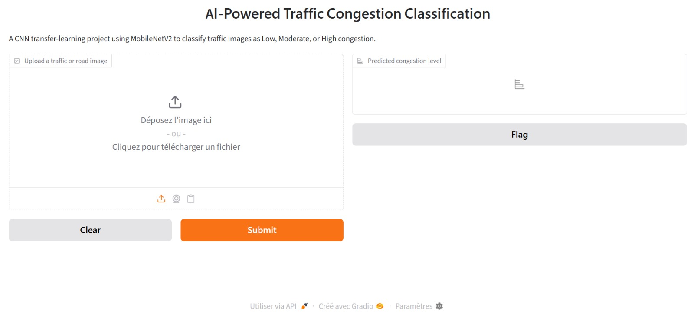
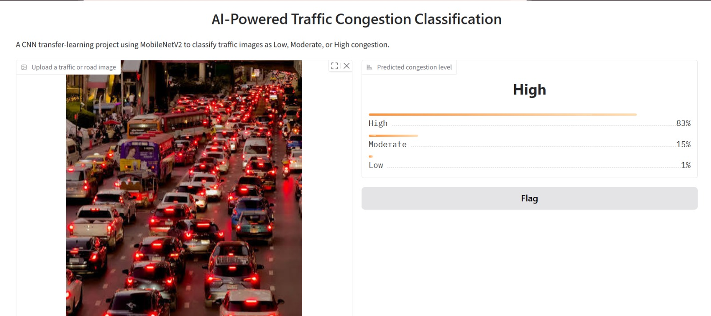

# AI-Powered Traffic Congestion Classification Using CNN Transfer Learning (MobileNetV2)

## 1. Project Overview

Traffic congestion is a major challenge in urban areas. It causes delays, increases fuel consumption, contributes to air pollution, and affects transportation efficiency.

This project develops an AI-powered traffic congestion classification system using Convolutional Neural Networks (CNN) and Transfer Learning.

The system uses the **MobileNetV2** architecture to analyze road and traffic images and classify them into three congestion categories:

- **Low:** Roads with relatively few vehicles.
- **Moderate:** Roads with a noticeable number of vehicles and some traffic buildup.
- **High:** Roads with heavy traffic and significant congestion.

A web-based application developed using Gradio allows users to upload traffic images and receive predictions from the trained model.

## 2. Project Objectives

The main objectives of this project are:

1. To understand the application of Artificial Intelligence in traffic monitoring.
2. To collect and prepare a traffic image dataset.
3. To preprocess images for deep learning.
4. To implement transfer learning using MobileNetV2.
5. To train a CNN model to classify traffic congestion.
6. To evaluate the model using classification metrics.
7. To develop an interactive application for traffic image classification.

## 3. Technologies and Tools

| Technology | Purpose |
|---|---|
| Python | Programming language |
| Google Colab | Model development and training |
| TensorFlow | Deep learning framework |
| Keras | Model building and training |
| MobileNetV2 | Transfer learning architecture |
| NumPy | Numerical operations |
| Pillow (PIL) | Image processing |
| Hugging Face Hub | Dataset source |
| Gradio | Web application interface |
| VS Code | Local application development |
| GitHub | Project documentation and source code hosting |

## 4. Dataset Description

The traffic image dataset was obtained from the Hugging Face Hub.

The original dataset contained four labels:

- High-traffic
- Low-traffic
- Medium-traffic
- No-traffic

For this project, the original labels were organized into three target categories:

- Low
- Moderate
- High

A balanced dataset was prepared by selecting 400 images for each category.

### Dataset Distribution

| Category | Number of Images |
|---|---:|
| Low | 400 |
| Moderate | 400 |
| High | 400 |
| **Total** | **1,200** |

### Dataset Splitting

The dataset was divided into training and validation sets using an 80:20 ratio.

| Dataset | Images | Percentage |
|---|---:|---:|
| Training | 960 | 80% |
| Validation | 240 | 20% |
| **Total** | **1,200** | **100%** |

The balanced dataset helps provide an equal number of images for each congestion category.

## 5. Model Architecture

This project uses MobileNetV2, a lightweight Convolutional Neural Network architecture designed for efficient image classification.

Transfer learning was applied using pretrained MobileNetV2 as the feature extraction component. A custom classification layer was added to predict the three congestion categories.

### Model Architecture Diagram



### Model Layers

The model contains the following layers:

1. Input Layer
2. Data Augmentation
3. Rescaling
4. MobileNetV2 Feature Extractor
5. Global Average Pooling 2D
6. Dropout
7. Dense Classification Layer

### Model Configuration

| Parameter | Value |
|---|---:|
| Input image size | 224 × 224 × 3 |
| Number of classes | 3 |
| Total parameters | 2,261,827 |
| Trainable parameters | 3,843 |
| Non-trainable parameters | 2,257,984 |
| Model format | Keras (.keras) |

The model includes an internal rescaling layer and uses MobileNetV2 as its feature extractor. Images are resized to 224 × 224 pixels before prediction.

## 6. Model Training

The model was trained using TensorFlow and Keras in Google Colab.

The training process consisted of two consecutive training phases, with 10 epochs in each phase, for a total of 20 training epochs.

The following metrics were monitored:

- Training accuracy
- Training loss
- Validation accuracy
- Validation loss

### First Training Phase

The first phase focused on training the classification model and monitoring its initial learning performance.



### Second Training Phase

The second phase continued training to improve the model's classification performance.



### Final Recorded Training Results

| Metric | Result |
|---|---:|
| Training accuracy | 74.58% |
| Training loss | 0.5749 |
| Validation accuracy | 71.25% |
| Validation loss | 0.6478 |

The training results show that the model learned to identify patterns in traffic images and achieved a validation accuracy of 71.25%.

## 7. Model Evaluation

The model was evaluated using a validation dataset containing 240 images.

### Training and Validation Performance

The graph below illustrates the changes in training accuracy and validation accuracy during the training process.



### Overall Performance

**Validation Accuracy: 71.25%**

The model correctly classified 171 out of 240 validation images.

### Classification Report

The classification report provides precision, recall, and F1-score for each congestion category.

| Class | Precision | Recall | F1-score | Support |
|---|---:|---:|---:|---:|
| Low | 0.73 | 0.82 | 0.77 | 71 |
| Moderate | 0.73 | 0.43 | 0.54 | 82 |
| High | 0.69 | 0.90 | 0.78 | 87 |
| **Accuracy** | | | **0.71** | **240** |
| Macro Average | 0.72 | 0.71 | 0.70 | 240 |
| Weighted Average | 0.72 | 0.71 | 0.70 | 240 |

### Confusion Matrix

The confusion matrix shows the actual and predicted congestion categories.

| Actual / Predicted | Low | Moderate | High |
|---|---:|---:|---:|
| Low | 58 | 9 | 4 |
| Moderate | 16 | 35 | 31 |
| High | 5 | 4 | 78 |



### Performance Discussion

- **Low congestion:** The model achieved a recall of 0.82, correctly identifying most low-congestion images.
- **Moderate congestion:** The model achieved a recall of 0.43, indicating difficulty distinguishing moderate traffic from other categories.
- **High congestion:** The model achieved a recall of 0.90, showing that it successfully identified most high-congestion images.

The results indicate that the model performs better at identifying Low and High congestion than Moderate congestion.

## 8. Application Development

A web application was developed using Gradio.

The application allows users to upload a traffic or road image and receive congestion classification predictions from the trained MobileNetV2 model.

### Application Workflow

1. The user uploads a traffic image.
2. The image is converted into RGB format.
3. The image is resized to 224 × 224 pixels.
4. The image is converted into a NumPy array.
5. The trained MobileNetV2 model processes the image.
6. The application displays the predicted congestion categories and confidence scores.

### Application Features

- Image upload functionality.
- Automatic image resizing.
- AI-powered traffic classification.
- Three congestion categories.
- Prediction confidence scores.
- Simple and user-friendly interface.

### Gradio Application Interface

The following screenshot shows the web interface developed using Gradio. Users can upload a traffic or road image and submit it for classification.



### Example Prediction Result

The following screenshot demonstrates the application's prediction output after an image is uploaded and submitted.



## 9. Project Structure

The project directory contains the following files and folders:

```text
Traffic_Congestion/
│
├── app.py
│
├── traffic_congestion_mobilenetv2.keras
│
├── class_names.json
│
├── requirements.txt
│
├── Dockerfile
│
├── README.md
│
└── images/
    ├── Model architecture and parameters.jpeg
    ├── Model Training.jpeg
    ├── Model Training2.jpeg
    ├── Model Evaluation.jpeg
    ├── Classification Report.jpeg
    ├── gradio_application.jpeg
    └── gradio_applicationresult.jpeg
```

### File Descriptions

| File | Description |
|---|---|
| `app.py` | Runs the Gradio prediction application |
| `traffic_congestion_mobilenetv2.keras` | Saved trained MobileNetV2 model |
| `class_names.json` | Contains the three output class names |
| `requirements.txt` | Contains the required Python packages |
| `Dockerfile` | Defines the application container configuration |
| `README.md` | Project documentation |
| `images/` | Contains project screenshots and evaluation results |

## 10. Installation and Setup

### Prerequisites

Install the following before running the application:

- Python version compatible with the installed TensorFlow release.
- pip package installer.
- Visual Studio Code (optional).
- Git (if cloning the repository).

### Step 1: Clone the Repository

```bash
git clone YOUR_GITHUB_REPOSITORY_URL
```

Replace `YOUR_GITHUB_REPOSITORY_URL` with the actual repository URL.

### Step 2: Navigate to the Project Folder

```bash
cd Traffic_Congestion
```

### Step 3: Install Dependencies

On Windows, run:

```powershell
py -m pip install -r requirements.txt
```

### Step 4: Run the Application

```powershell
py app.py
```

The application will start locally.

Open the local URL displayed in the terminal. It will usually be:

```text
http://127.0.0.1:7860
```

If Gradio selects another port, use the actual URL displayed in the terminal.

## 11. Requirements

The project requires the following Python packages:

```text
tensorflow
gradio
numpy
Pillow
```

Install all dependencies using:

```powershell
py -m pip install -r requirements.txt
```

## 12. Running the Application with Gradio

The application uses Gradio to provide an interactive interface.

When the application starts, users can:

1. Open the Gradio application.
2. Upload a traffic or road image.
3. Click the Submit button.
4. View the predicted congestion categories.
5. Examine the confidence scores for each category.

The prediction output contains confidence scores for:

- Low
- Moderate
- High

The Gradio share link can also provide temporary public access while the application is running. It is not a permanent hosting solution and may stop working when the application session ends.

## 13. Results

The project successfully developed a traffic congestion classification model using MobileNetV2 transfer learning.

The main results are:

- Dataset size: 1,200 images.
- Number of classes: 3.
- Training images: 960.
- Validation images: 240.
- Validation accuracy: 71.25%.
- Correct validation predictions: 171 out of 240.
- Model architecture: MobileNetV2.
- Application framework: Gradio.

The trained model was saved in Keras format and integrated into the Gradio application for image-based traffic congestion prediction.

## 14. Limitations

The project has some limitations:

1. The validation accuracy is 71.25%, so predictions are not always correct.
2. Moderate congestion has a relatively low recall.
3. The dataset contains a limited number of images.
4. Image quality, lighting, weather, and camera angles may affect predictions.
5. The current application classifies uploaded images rather than continuously monitoring live traffic.

## 15. Future Improvements

The project can be improved through:

1. Increasing the size and diversity of the traffic image dataset.
2. Improving Moderate congestion classification by collecting more representative images.
3. Fine-tuning selected MobileNetV2 layers.
4. Comparing MobileNetV2 with other architectures such as EfficientNet and ResNet.
5. Integrating real-time traffic camera feeds.
6. Developing a mobile application.
7. Deploying the application on a permanent hosting platform.

## 16. Conclusion

This project demonstrates the application of Artificial Intelligence and deep learning in traffic congestion classification.

Using MobileNetV2 transfer learning, the system was trained to classify traffic images into Low, Moderate, and High congestion categories.

The model achieved a validation accuracy of 71.25% and was evaluated using precision, recall, F1-score, and a confusion matrix.

A Gradio application was also developed to allow users to upload traffic images and receive predictions through a simple web-based interface.

Overall, the project demonstrates how computer vision and transfer learning can support automated traffic analysis and provide a foundation for more advanced intelligent transportation systems.

## 17. References

1. Sandler, M., Howard, A., Zhu, M., Zhmoginov, A., and Chen, L. C. (2018). *MobileNetV2: Inverted Residuals and Linear Bottlenecks*. Proceedings of the IEEE Conference on Computer Vision and Pattern Recognition (CVPR).
2. TensorFlow Documentation: https://www.tensorflow.org/
3. Keras Documentation: https://keras.io/
4. Gradio Documentation: https://www.gradio.app/docs
5. Hugging Face Documentation: https://huggingface.co/docs
6. Google Colab: https://colab.research.google.com/

---

**Project Title:** AI-Powered Traffic Congestion Classification Using CNN Transfer Learning (MobileNetV2)

**Final Validation Accuracy:** 71.25%

**Model Architecture:** MobileNetV2

**Application:** Gradio Web Interface

## Project Report

You can access the complete project report using the link below:

[View Full Project Report (PDF)](report/25MDA10002_Desiree.pdf)
